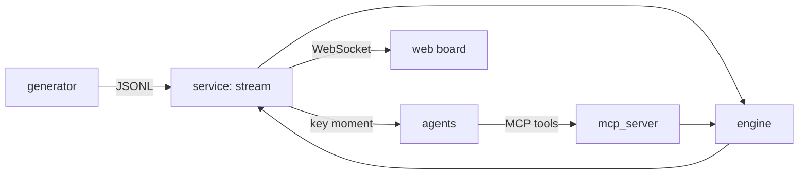

# Architecture

## Overview

## Local vs Azure
_TODO (Phase 8)_

## Process flow
_TODO_

## Agents and router
_TODO (Phase 6)_

## Data contracts
Defined once as Pydantic v2 models in `contracts/`, exported to JSON Schema in `contracts/schema/`, and compiled to TypeScript in `web/src/types/contracts.ts` (`uv run python tasks.py schema`). A test fails if the committed schema drifts from the models.

One clock (`t_ms` from kick-off) and one coordinate system: 105 x 68 m, origin at the home team's defending bottom-left corner, `z` = ball height. Coordinates may sit up to 5 m outside the pitch (run-offs, nets); probabilities are validated to 0-1.

| Record | Frequency | Module |
| --- | --- | --- |
| `MatchMeta`, `PlayerProfile` | once | `contracts/match.py` |
| `TrackingFrame`, `Event`, `WorkloadState` | 10 Hz / per action / 1 Hz | `contracts/tracking.py` |
| `KeyMoment`, `OptionSet`, `WhatIf`, `Overlay` | per moment / card | `contracts/analysis.py` |

## Design decisions
_TODO_

## Security and cost
_TODO_
