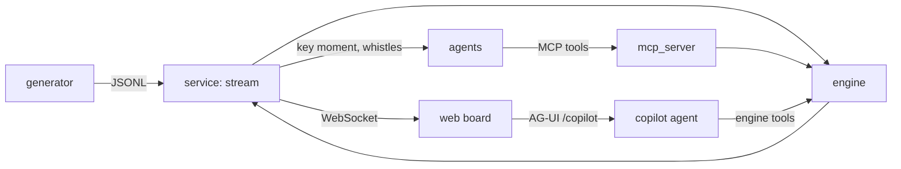
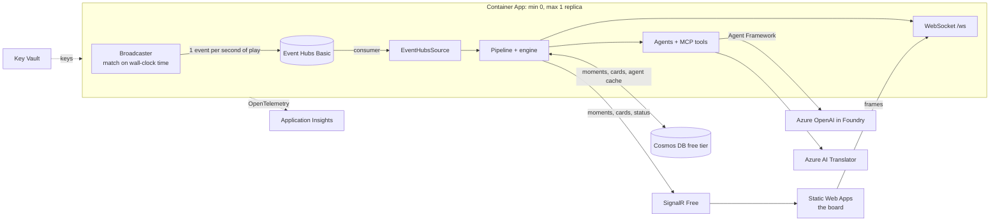
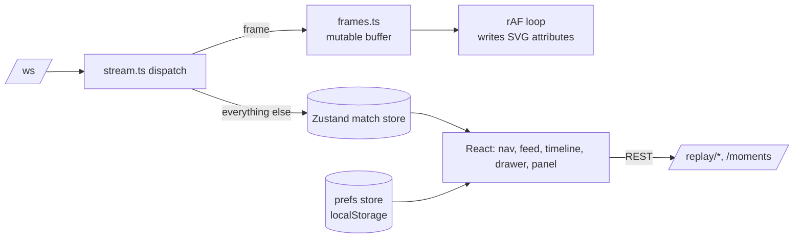
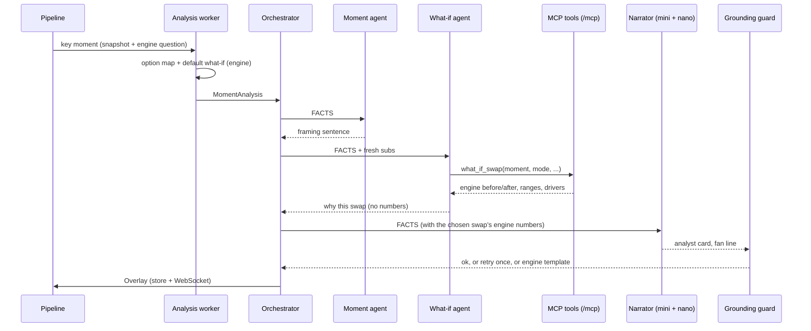
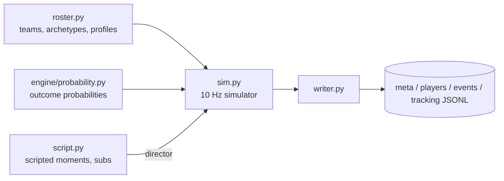
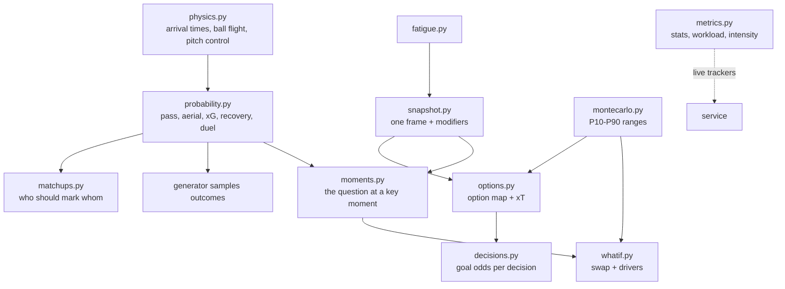

# Architecture

## Overview

## Local vs Azure
The service talks to infrastructure only through three ports (`service/ports.py`). `RUN_MODE` picks the adapters in one factory (`service/factory.py`); each Azure adapter falls back to the local one if it is not configured.

| Port | `RUN_MODE=local` | `RUN_MODE=azure` |
| --- | --- | --- |
| `StreamSource` | `FileReplay`: JSONL at 1/2/4/8×, pause, seek | `EventHubsSource`: shared live broadcast (+ in-process `EventHubsBroadcaster`) |
| `StateStore` | `MemoryStore` | `CosmosStore`: write-through, hydrated on wake; partition `<match_id>@<data version>` (a hash of the match files and the engine), so a regenerated match never wakes up with old cards |
| `Publisher` | `WebSocketPublisher` | `HybridPublisher`: SignalR for low-rate, WebSocket for frames |

**Why hybrid real-time.** SignalR Free allows 20,000 messages a day, but 10 Hz frames would use that in about half an hour for one viewer. So frames, events, stats and workload use the Container App's own WebSocket, and SignalR carries the 30–50 low-rate messages per viewer per match. That keeps it at $0.

**Why a shared broadcast.** Replay controls are shared on the server, so on a public URL one judge's seek would move everyone's board. In Azure the match is live TV instead: it loops every 90 minutes on wall-clock time, so a container waking from zero joins wherever the match "is". Key moments are replayed as personal client-side clips (`GET /moments/{id}/frames`). Locally, the full replay controls remain.

**Security.** One user-assigned managed identity holds all data-plane access: AcrPull, Key Vault Secrets User, Event Hubs Data Owner, the Cosmos DB Built-in Data Contributor, and SignalR REST API Owner. Event Hubs, Cosmos DB and SignalR have local (key) auth disabled. The Azure OpenAI and Translator keys live in Key Vault and reach the app as Key Vault secret references; with `AZURE_OPENAI_USE_MANAGED_IDENTITY=true` the model key isn't needed at all. Nothing secret is in the repo or the image.

**Cost model.** Spend comes from the replica's vCPU and GiB-seconds while someone is watching, beyond the monthly free grant of 180,000 vCPU-seconds, plus Event Hubs Basic (about $11/month) and registry Basic (about $5/month). Every other service is on a free tier. Scale-to-zero keeps idle cost at $0.

**Seeking.** At start-up the pipeline replays the whole match silently (about 10 s, including a snapshot at every on-ball decision for the player panel). It saves a copy of its state every match minute and collects every key moment, then warms the analysis cache. A seek restores the nearest checkpoint and fast-forwards at most 599 frames. A test checks the result is identical to a straight replay.

**Backpressure.** Each WebSocket client has its own bounded queue. A slow browser drops its oldest messages instead of stalling the pipeline.

## Process flow
1. **Ingest.** The source emits a `FramePacket` (tracking frame + events) on the replay clock.
2. **Interpret.** Workload, fatigue, team stats and intensity update incrementally.
3. **Publish.** The frame is forwarded byte-for-byte; stats go out every second, workload every 5 s, intensity every minute.
4. **Detect.** `MomentDetector` checks the frame and its events against the key-moment rules.
5. **Analyse.** A detected moment is queued; a worker computes the option map and the what-if off the event loop.
6. **Store.** Moments and analyses go to the `StateStore`, keyed by deterministic ids.
7. **Explain.** The agents turn the analysis into grounded cards; at the whistles they write the recap and the player-panel lines.
8. **Render.** The board draws frames, cards, arrows and ghosts; the player panel and the copilot read the engine on demand.

## The board (web/)

- **Frames bypass React.** At 8× there are 80 frames a second. They go into a two-frame buffer. A `requestAnimationFrame` loop interpolates between the last two and writes `transform` attributes directly, so React re-renders at most 10 times a second (the clock). A seek or a gap snaps instead of gliding. With `prefers-reduced-motion` it shows frames as they arrive.
- **Cost at 8×:** about 16 µs to handle a message and 8 µs per interpolated sample, which is under 2 ms of main-thread time per second.
- **Moments in a replay.** `/moments?all=true` gives the scrubber every marker up front. Missing analyses are fetched on demand, so seeking forward still fills the feed. After a seek the server republishes stats, workload and intensity immediately.
- **Pages.** Hash routes (`#/` home, `#/how`, `#/live`, `#/recap`), so any static host serves them with no rewrite rules. Home, How it works and Recap are lazy-loaded chunks; the scroll pages use Lenis smooth scrolling (snap on desktop, off for reduced motion).
- **Layout.** The live page is one container: the score strip and table (pitch, control rail, timeline, benches) on the left, the key moments and the copilot stacked on the right, split by a draggable handle (the size is saved per browser). The right column is at least 820px tall, so a smaller pitch gives the moments and copilot more room. Design rules are in [DESIGN.md](DESIGN.md). Hovering a token shows a stats card that follows the player; clicking opens a non-modal player panel, so the board keeps playing.
- **Fan mode.** The follow-cam animates the SVG `viewBox` in the same rAF loop that moves the players (48 m wide, eased, clamped to the pitch). Commentary lines are templates over the event stream (`lib/commentary.ts`); the momentum bar compares each team's possession time and threat (xG and shots) over the last five minutes from successive engine stats snapshots and shows only a bar and words; banners fire when the clock plays across a goal or big moment, so replays get them too.
- **Third-party styles.** CopilotKit's stylesheet defines its own `--muted` and similar variables; our components inside its chat re-apply our tokens with `.dl-tokens`.
- **Recap story.** `GET /recap` builds the full-time recap from the pipeline's final state (kept from the warm-up), so it works whatever the live replay is doing. Turning points are ordered by what-if swing. Each chapter's scroll progress (Framer Motion `useScroll`) picks a frame from `GET /moments/{id}/frames` for the pinned `StaticBoard`.
- **Lazy chunks.** The stats drawer (recharts) loads on first open and the copilot (CopilotKit) only on the live page, keeping the initial JS at about 550 KB (180 KB gzipped).

## Agents and router
| Trigger | Runs (agents/router.py) |
| --- | --- |
| Every frame or event | Engine only, no model |
| Key moment | Moment → What-if → Narrator |
| Fatigue over 80 | What-if (fresh sub, engine) → Narrator |
| Language change | Translator only (UI wording ships pre-translated; match text and cards are translated once and cached; the copilot is told the language) |
| Half-time, full-time | Interpreter → Recap → Decisions (one call per team) |
| A viewer asks the copilot | Copilot agent with engine tools (rate-limited) |

- **Realistic swaps.** A substitution is only proposed when a coach would make it: from 55', or earlier once the actor's fatigue reaches 60 (`engine/whatif.sub_realistic`). Before that the What-if agent gets an empty bench and the default swap is a specialist archetype that keeps the actor's own fatigue, so a 1' miss is compared with a better finisher, not with fresh legs.
- **Shared state, not message passing.** Agents never hand numbers to each other. The What-if agent's swap goes through the MCP tool into the `StateStore`, and the Narrator reads the engine's result.
- **Timeouts and retry.** Each call has 25 s. After an error, the one retry uses the fallback deployment; after an ungrounded answer, it uses the same model, told which numbers were wrong. Then the card falls back to the template.
- **Cache.** Answers are cached by match, moment (or recap), agent, model and prompt version, in memory and in `data/cache/` (gitignored). Replaying a match costs nothing after the first run. A cached what-if stores the tool arguments and replays them on the engine, so cached numbers are always engine numbers.
- **Cost guard.** Model calls happen only at key moments and the two whistles: about 14 moments and 2 recaps per match at up to 4 calls each, plus one Decisions call per team at each whistle (4 a match).
- **Match copilot.** A chat beside the board, under the key moments ([CopilotKit](https://copilotkit.ai) React, MIT) talks the AG-UI protocol straight to `POST /copilot` on the stream service (`agent-framework-ag-ui`), so there's no extra Node runtime to host. The copilot is one Agent Framework agent with engine tools: `find_player`, `player_stats`, `player_decisions`, `best_marker` and `match_state`. The board passes what the viewer is looking at (minute, score, persona, followed player, open panel, moment on screen) as agent context, and renders `best_marker` results as a chart in the chat. Each browser sends a random viewer id, which scopes its chat threads. Spend is bounded: 40 questions an hour per caller (keyed on the client address the Container Apps proxy adds to `X-Forwarded-For`), 600 an hour overall, and request bodies over 256 KB are refused. CopilotKit Intelligence (hosted threads and analytics) isn't used, and the CopilotKit inspector is off, so the browser talks only to our own hosts (fonts are self-hosted).
- **Marking advice.** `engine/matchups.py` scores every possible marker (on the pitch or a fresh sub) against an attacker with the same duel models the match uses: headers (`aerial_win`), foot races (`recovery_run`) and tackles (`duel_success`), all slowed by live fatigue. The three are weighted by the attacker's type (a target man is 60% headers, a winger 50% races), scaled by position fit (including positions the marker has played), with a small bonus when the marker's stronger foot suits the side the attacker attacks. The scenarios are standardised, so scores rank markers against each other; they are not the odds of one real duel. A follow-up like "he's already marking someone" re-runs the ranking with that player excluded.
- **Player decisions.** The engine ranks every player's decisions by *goal odds*, the chance the move ends in a goal (xG for a shot, p_success × threat at the end point otherwise): chosen vs the best candidate, and lost duels the opponents turned into a shot within 15 s. Live, the panel's lines are engine templates ("a pass to Venn would have raised the goal odds from 2% to 9%"); at half-time and full-time the Decisions agent rewrites them in one call per team, and each line is grounded and length-checked on its own. Nothing after the replay clock is used, so the panel never gives away what comes next.
- **MCP security.** The MCP SDK's DNS-rebinding protection stays on; the agents reach the tools on 127.0.0.1.

## Synthetic match generator

- **Deterministic:** one NumPy `Generator` seeded from the match seed; no wall-clock or hash-order dependence. Same seed → byte-identical files (tested).
- **Outcome first, then physics:** when a player passes, crosses or shoots, the outcome is sampled at the kick and the ball flight is built to match it. A failed pass goes to a point the interceptor can actually reach in time (engine arrival times), or straight at him, so the ball is never left dead on the grass. A loose ball is reserved for the team that "won" it for 0.6 s, then anyone's, with the nearest player from each side chasing; one player per side also runs for every clearance. The event log and tracking agree (a test holds disagreement under 1%), and dead-ball stops of a second or more fell from 73 to 2 per match (both scripted free kicks).
- **Scripted moments** are Python generators run by a director: they stop play with a restart near the scene, steer the players involved, and force the outcome. The key event carries `scripted:<moment>` tags as ground truth for testing the detector (which never reads them).

## Probability and metrics engine

- **One source of numbers.** The generator calls the engine to sample every pass, shot, header and duel, and slows players with the engine's fatigue model. So the ground truth is drawn from the same probabilities the app explains. Calibration on seed 42: pass ECE 0.012, Brier 0.134.
- **Spells of pressure.** Around each scripted moment, the attacking side runs and shoots more for up to 2 minutes before and 90 s after, and duels are fiercer. Big moments happen in intense spells, and this makes the intensity index rise around them, as F9 needs.
- **Incremental by design.** `WorkloadTracker`, `StatsTracker` and `IntensityTracker` consume one frame or event at a time, so the live service and batch analysis share code.

## Data contracts
**Event semantics.** `outcome` is always from `player_id`'s point of view. For a pass or cross, `target_id` is the intended receiver and `end` the intended point, even when it fails. In an aerial duel `player_id` is the defending-side player and `target_id` the attacker. For tackle, pressure and foul, `player_id` is the defender and `target_id` the ball carrier. For a dribble, `player_id` is the carrier. The full list is in the `Event` docstring (`contracts/tracking.py`).

Defined once as Pydantic v2 models in `contracts/`, exported to JSON Schema in `contracts/schema/`, and compiled to TypeScript in `web/src/types/contracts.ts` (`uv run python tasks.py schema`). A test fails if the committed schema drifts from the models.

One clock (`t_ms` from kick-off) and one coordinate system: 105 x 68 m, origin at the home team's defending bottom-left corner, `z` = ball height. Coordinates may sit up to 5 m outside the pitch (run-offs, nets); probabilities are validated to 0-1.

| Record | Frequency | Module |
| --- | --- | --- |
| `MatchMeta`, `PlayerProfile` | once | `contracts/match.py` |
| `TrackingFrame`, `Event`, `WorkloadState` | 10 Hz / per action / 1 Hz | `contracts/tracking.py` |
| `KeyMoment`, `OptionSet`, `WhatIf`, `Overlay` | per moment / card | `contracts/analysis.py` |
| `PlayerStats`, `PlayerDecisions`, `MarkingAdvice` | on request | `contracts/player.py` |

## Design decisions
| Decision | Why | Trade-off |
| --- | --- | --- |
| Rules-based simulator, not physics or learned agents | Deterministic, fast (90 min in about a minute), and lets us script key moments exactly | Movement is football-shaped, not broadcast-accurate |
| Scripted moments via dead-ball restarts | A restart is a natural way to place the ball where the scene needs it | Each scripted moment starts with a short stoppage |
| Gzipped tracking in the repo | 13 MB instead of 73 MB keeps the repo clonable | Replay reads `.jsonl.gz` |
| Analytic arrival-time models, not learned ones | Transparent, explainable maths with no training data (synthetic only) | Less nuanced than models trained on real tracking |
| Common random numbers in what-ifs | Before and after use the same Monte Carlo draws, so the difference is the swap, not noise | Ranges are correlated, not independent |

**Known generator limitations (seed 42):** wide players and full-backs cover 12–15 km with 2–3 km of high-speed running, above typical real values (10–12 km and about 1 km); centre-backs cover about 10.5 km. Most failed passes are won by the opponent and logged as interceptions, so interceptions (~220) run higher than in real data. There are no bookings (fouls carry no cards). The generator and the engine share one fatigue model: the engine replays it from tracking, and its result is within 0.5 points of the live tracker (tested). Seed 42 has fewer shots (14) and fouls (11) than a typical match.

## Security and cost
See **Local vs Azure** above: managed identity everywhere, keys only in Key Vault, scale-to-zero, free tiers. The copilot endpoint adds per-caller and overall hourly caps and a request-size limit; chat threads are scoped per viewer. Agent Framework telemetry runs with sensitive data off, so prompts and answers never reach Application Insights.
