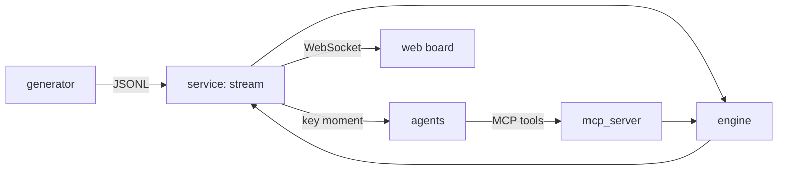
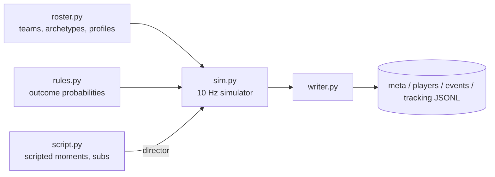
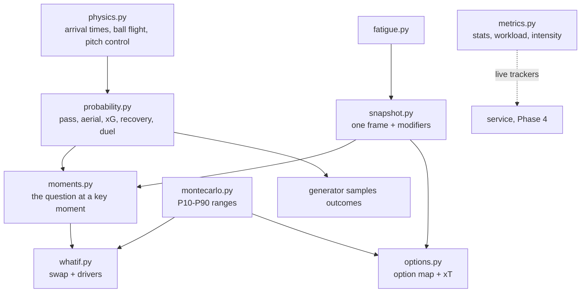

# Architecture

## Overview

## Local vs Azure
_TODO (Phase 8)_

## Process flow
_TODO_

## Agents and router
_TODO (Phase 6)_

## Synthetic match generator

- **Deterministic:** one NumPy `Generator` seeded from the match seed; no wall-clock or hash-order dependence. Same seed → byte-identical files (tested).
- **Outcome first, then physics:** when a player passes, crosses or shoots, the outcome is sampled at the kick and the ball flight is built to match it. If the ball then runs loose, only the team that "won" it may collect, so the event log and tracking agree (a test holds disagreement under 1%; it is 0.2% on seed 42).
- **Scripted moments** are Python generators run by a director: they stop play with a restart near the scene, steer the players involved, and force the outcome. The key event carries `scripted:<moment>` tags as ground truth for the Phase 3 detector.

## Probability and metrics engine

- **One source of numbers.** The generator calls the engine to sample every pass, shot, header and duel, and slows players with the engine's fatigue model. So the ground truth is drawn from the same probabilities the app explains. Calibration on seed 42: pass ECE 0.022, Brier 0.141.
- **Spells of pressure.** Around each scripted moment, the attacking side runs and shoots more for up to 2 minutes before and 90 s after, and duels are fiercer. Big moments happen in intense spells, and this makes the intensity index rise around them, as F9 needs.
- **Incremental by design.** `WorkloadTracker`, `StatsTracker` and `IntensityTracker` consume one frame or event at a time, so the live service (Phase 4) and batch analysis share code.

## Data contracts
**Event semantics.** `outcome` is always from `player_id`'s point of view. For a pass or cross, `target_id` is the intended receiver and `end` the intended point, even when it fails. In an aerial duel `player_id` is the defending-side player and `target_id` the attacker. For tackle, pressure and foul, `player_id` is the defender and `target_id` the ball carrier. For a dribble, `player_id` is the carrier. The full list is in the `Event` docstring (`contracts/tracking.py`).

Defined once as Pydantic v2 models in `contracts/`, exported to JSON Schema in `contracts/schema/`, and compiled to TypeScript in `web/src/types/contracts.ts` (`uv run python tasks.py schema`). A test fails if the committed schema drifts from the models.

One clock (`t_ms` from kick-off) and one coordinate system: 105 x 68 m, origin at the home team's defending bottom-left corner, `z` = ball height. Coordinates may sit up to 5 m outside the pitch (run-offs, nets); probabilities are validated to 0-1.

| Record | Frequency | Module |
| --- | --- | --- |
| `MatchMeta`, `PlayerProfile` | once | `contracts/match.py` |
| `TrackingFrame`, `Event`, `WorkloadState` | 10 Hz / per action / 1 Hz | `contracts/tracking.py` |
| `KeyMoment`, `OptionSet`, `WhatIf`, `Overlay` | per moment / card | `contracts/analysis.py` |

## Design decisions
| Decision | Why | Trade-off |
| --- | --- | --- |
| Rules-based simulator, not physics or learned agents | Deterministic, fast (90 min in ~25 s), and lets us script key moments exactly | Movement is football-shaped, not broadcast-accurate |
| Scripted moments via dead-ball restarts | A restart is a natural way to place the ball where the scene needs it | Each scripted moment starts with a short stoppage |
| Gzipped tracking in the repo | 13 MB instead of 73 MB keeps the repo clonable | Replay reads `.jsonl.gz` |
| Analytic arrival-time models, not learned ones | Transparent, explainable maths with no training data (synthetic only) | Less nuanced than models trained on real tracking |
| Common random numbers in what-ifs | Before and after use the same Monte Carlo draws, so the difference is the swap, not noise | Ranges are correlated, not independent |

**Known generator limitations (seed 42):** wide players and full-backs cover 12–14 km with 2–3 km of high-speed running, above typical real values (10–12 km and about 1 km). Centre-backs cover about 9.5 km. Every failed pass is collected by the opponent and logged as an interception, so interceptions (~190) run higher than in real data. The generator and the engine share one fatigue model: the engine replays it from tracking, and its result is within 0.5 points of the live tracker (tested). Seed 42 has fewer shots (~19) and fouls (~14) than a typical match.

## Security and cost
_TODO_
