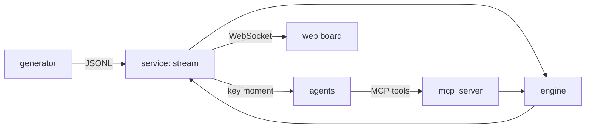

# Architecture

## Overview

## Local vs Azure
_TODO (Phase 8)_

## Process flow
_TODO_

## Agents and router
_TODO (Phase 6)_

## Data contracts
_TODO (Phase 1)_

## Design decisions
_TODO_

## Security and cost
_TODO_
